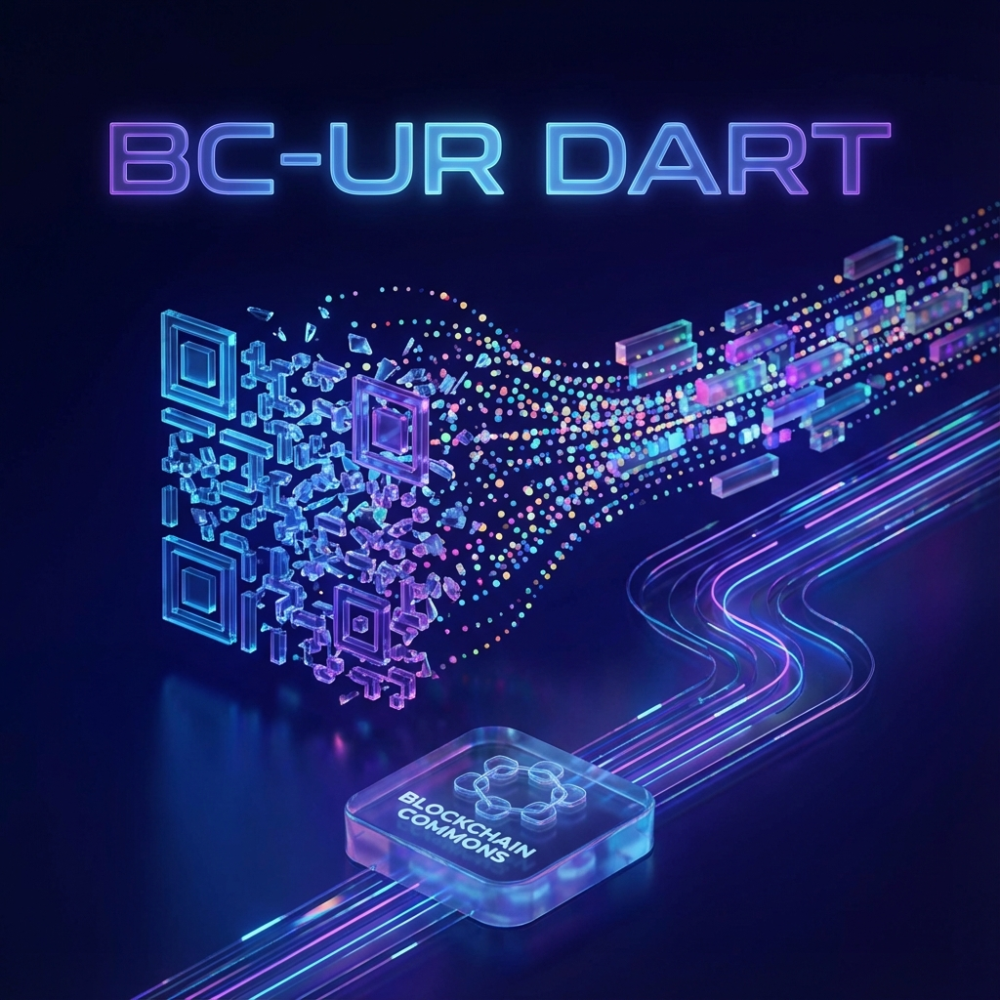
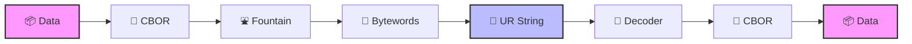

# 💎 BC-UR Dart



<div align="center">

[](https://github.com/BlockchainCommons/bc-ur)
[](https://opensource.org/licenses/MIT)
[](#)

**[English](#-english) | [繁體中文](#-繁體中文)**

</div>

---

<a name="-english"></a>
## 🌏 English

### Overview
A premium, high-performance **pure Dart** implementation of the **BC-UR (Blockchain Commons Uniform Resources)** specification. 

This library provides **100% byte-for-byte algorithmic parity** with the official C++ reference implementation, ensuring flawless interoperability with professional hardware wallets like **Keystone** and **Passport**.

### 🚀 Key Features

*   ✅ **100% C++ Reference Compliant** – Perfect parity with official test vectors.
*   ✅ **Robust Peeling Decoder** – Advanced Gaussian-elimination recovery logic.
*   ✅ **Fountain Code Engine** – Native Luby transform implementation for air-gapped data.
*   ✅ **Pure Dart** – Zero Flutter dependencies. Runs on Server, CLI, and Mobile.
*   ✅ **Specification Standards** – Full support for CBOR (RFC 8949) and Bytewords.

---

<a name="-繁體中文"></a>
## 🇹🇼 繁體中文

### 概覽
這是一個專為 Dart 生態系開發的 **BC-UR (Blockchain Commons Uniform Resources)** 協議高階實作。

本函式庫與官方 C++ 參考實作完全一致，達到 **100% 位元級對等**，確保與 **Keystone** 和 **Passport** 等專業硬體錢包之間的無縫互操作性。

### 🚀 核心特性

*   ✅ **100% C++ 兼容** – 通過官方完整測試套件驗證。
*   ✅ **強健的解碼引擎** – 採用高性能「剝離解碼」演算法，輕鬆還原多部分數據。
*   ✅ **噴泉碼技術** – 原生實作離網 (Air-gapped) 數據傳輸專用的噴泉碼。
*   ✅ **純 Dart 實作** – 無任何 Flutter 依賴，可用於後端、CLI 或行動端。
*   ✅ **標準化支援** – 嚴格遵循 CBOR (RFC 8949) 與 Bytewords 規範。

---

## 📊 Architecture / 技術架構

### Data Flow / 數據流


---

## 📦 Installation / 安裝

```yaml
dependencies:
  bc_ur:
    git:
      url: https://github.com/ImL1s/bc-ur-dart.git
```

---

## 🛠 Quick Start / 快速上手

### Single Part / 單部分
```dart
final ur = BCUR.fromData('crypto-request', {'address': 'bc1q...', 'amount': 1000000});
print(ur.toString()); // ur:crypto-request/...
```

### Multipart (Animated QR) / 多部分 (動態 QR)
```dart
// Encoder / 編碼
final encoder = BCURFountainEncoder(largeUR, maxFragmentLength: 100);
final part = encoder.nextPart();

// Decoder / 解碼
final decoder = BCURFountainDecoder();
decoder.receivePart(scannedPart);
if (decoder.isComplete) {
  print(decoder.getResult());
}
```

---

## 🛡 Verification / 驗證

```bash
dart test
```

---

## 📄 License / 授權
MIT License. Built by [ImL1s](https://github.com/ImL1s) @ **Blockchain Commons** specs.
